<!-- HERO -->
:::{.hero-section .column-screen}
:::{.hero-content}

[RECHERCHE · MATÉRIAUX · CIRCULARITÉ]{.eyebrow}

# Transformer les déchets plastiques en matériaux de demain.

Explorer le surcyclage distribué des déchets plastiques en mélange grâce à la fabrication additive open source.

:::{.hero-buttons}

[Découvrir le projet →](research/){.btn-primary}

[Explorer nos recherches ↓](research/){.btn-secondary}

:::
:::
:::

  

[NOTRE OBJECTIF]{.eyebrow}

## Des déchets à de nouvelles [possibilités]{style="color: green;"}

Notre objectif de recherche est d’étudier, de mettre en œuvre et d’évaluer le ***potentiel de surcyclage*** des déchets plastiques en mélange par compatibilisation réactive in situ, en s’appuyant sur la **fabrication additive open source**.

::: {.grid .process-section}

::: {.g-col-12 .g-col-md-3 .process-card}

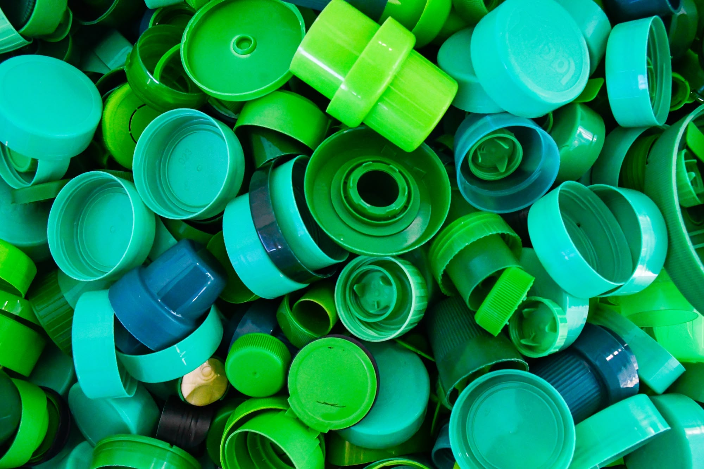{alt="Déchets plastiques en mélange"}
[01]{.step-number}

### Déchets plastiques en mélange
Les opérations de tri et de nettoyage rendent difficile le traitement local des plastiques post-consommation.

:::

::: {.g-col-12 .g-col-md-3 .process-card}

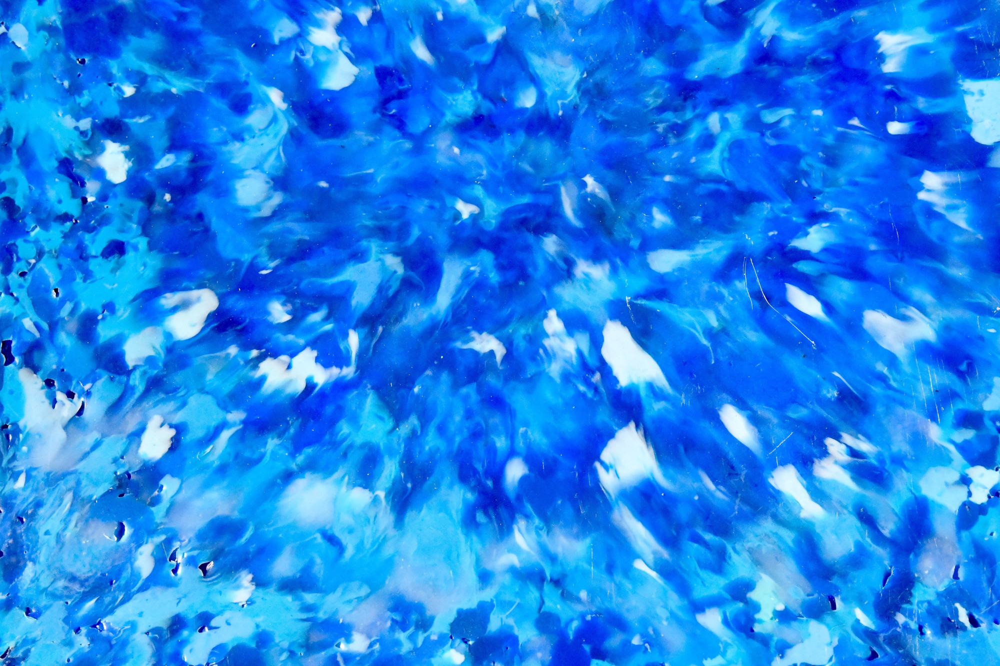{alt="Déchets plastiques en mélange"}
[02]{.step-number}

### Compatibilisation réactive

Améliorer les propriétés des mélanges de matières plastiques.

:::

::: {.g-col-12 .g-col-md-3 .process-card}

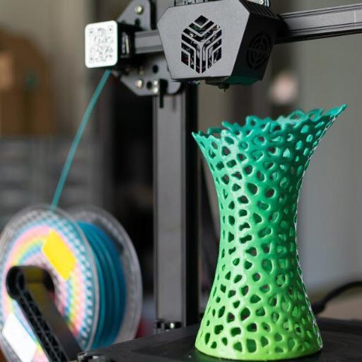{alt="Déchets plastiques en mélange"}
[03]{.step-number}

### Impression 3D open source
Donner de nouveaux usages aux plastiques post-consommation.

:::

::: {.g-col-12 .g-col-md-3 .process-card}

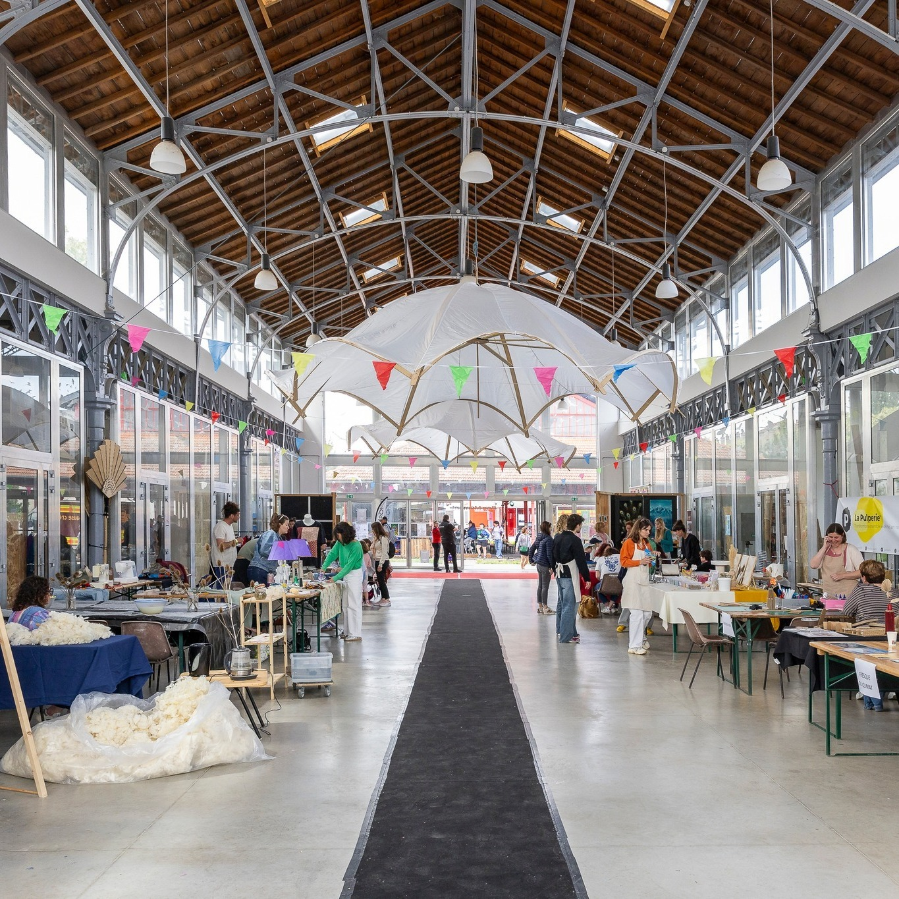{alt="Déchets plastiques en mélange"}
[04]{.step-number}

### Perspective sociotechnique

Mieux comprendre les usages appropriés des déchets plastiques au sein d’une communauté de fabrication urbaine.

:::

:::

::: {.grid .align-items-center }

::: {.g-col-12 .g-col-md-7 }

[NOTRE APPROCHE]{.eyebrow}

## Une perspective multiniveau du [surcyclage distribué]{fg="orange"}

Le projet UP3DCYCLING s’appuie sur une expertise pluridisciplinaire couvrant trois domaines : 1) la science des polymères, 2) les procédés de fabrication additive et 3) les systèmes sociotechniques.
L’articulation de ces trois niveaux repose sur des approches expérimentales, de modélisation et de construction de scénarios. Elle constitue une valeur ajoutée majeure du projet, permettant une compréhension globale des dynamiques techniques et sociales.

:::

::: {.g-col-12 .g-col-md-5 }

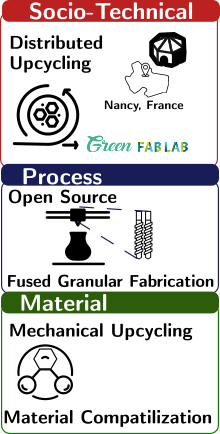{width="100%" fig-align="center"}

:::

:::

## Dernières [actualités] du projet{fg="green"}

::: {#news}

:::

[Plus d’actualités &rarr;](news/){.btn-primary}

# Nos partenaires académiques {style="text-align: center"}

::: {.grid .align-items-center .column-page-inset}

::: {.g-col-2}
{width="150px" fig-align="center"}
:::

::: {.g-col-2}
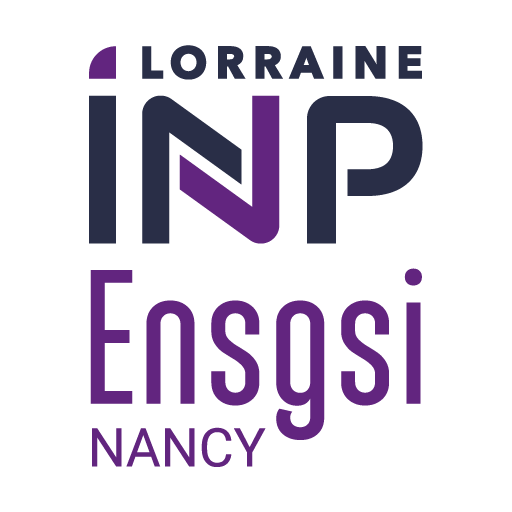{width="100px" fig-align="center"}
:::

::: {.g-col-2}
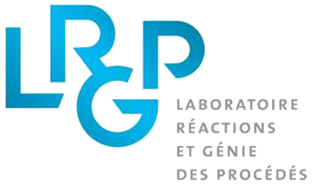{width="120px" fig-align="center"}
:::

::: {.g-col-2}
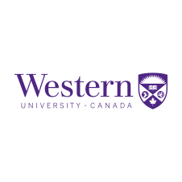{width="200px" fig-align="center"}
:::

::: {.g-col-2}
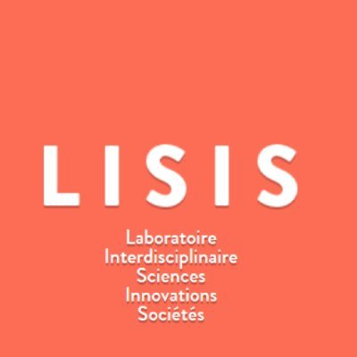{width="120px" fig-align="center"}
:::

::: {.g-col-2}
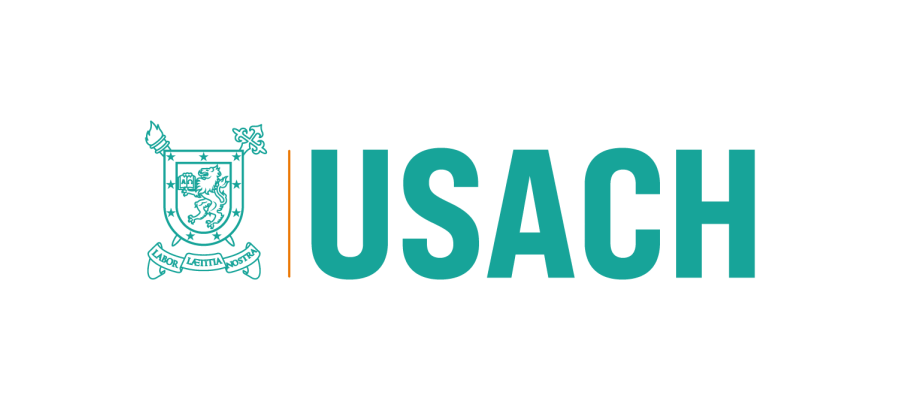{width="240px" fig-align="center"}
:::

::: 

# Nos partenaires de la société civile {.title-block style="text-align: center"}

::: {.grid .align-items-center }

::: {.g-col-3 .g-start-2}
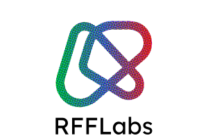{width="85%" fig-align="center"}
:::

::: {.g-col-3 .g-start-5}
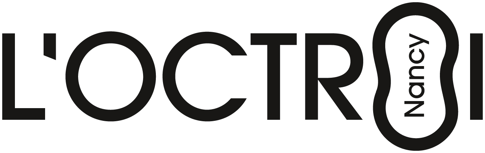{width="85%" fig-align="center"}
:::

::: 

