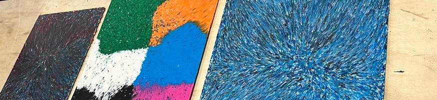
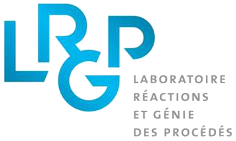
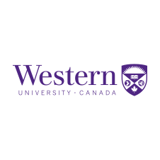
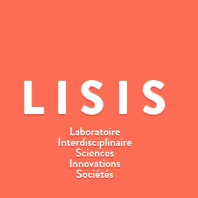
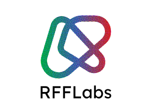
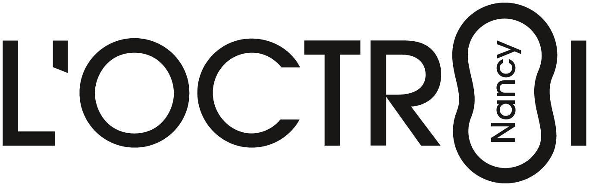

:::{.column-screen-inset}
{width="100%"}
:::

::: {.grid .align-items-center }

::: {.g-col-12 .g-col-md-8 }

## Our Aim

Our overall research aims is to study, implement, and evaluate the ***upcycling potential*** of mixed plastic waste via in-situ reactive compatibilization using **open-source additive manufacturing**.

:::

::: {.g-col-12 .g-col-md-4 }

{width="85%" fig-align="center"}

:::

:::

---

::: {.grid .align-items-center }

::: {.g-col-12 .g-col-md-4 .order-last .order-md-first}

{width="85%"}

:::

::: {.g-col-12 .g-col-md-8 .order-first .order-md-last}

# Mission

Our overall research aims is to study, implement, and evaluate the ***upcycling potential*** of mixed plastic waste via in-situ reactive compatibilization using **open-source additive manufacturing**.

:::

::: 

# News of the Project

:::{.column-screen-inset}
{width="100%"}
:::

# Our Academical Allies {style="text-align: center"}

::: {.grid .align-items-center }

::: {.g-col-3}
{width="85%" fig-align="center"}
:::

::: {.g-col-3}
{width="85%" fig-align="center"}
:::

::: {.g-col-3}
{width="85%" fig-align="center"}
:::

::: {.g-col-3}
{width="85%" fig-align="center"}
:::

::: 

# Our Societal Allies {.title-block style="text-align: center"}

::: {.grid .align-items-center }

::: {.g-col-3 .g-start-2}
{width="85%" fig-align="center"}
:::

::: {.g-col-3 .g-start-5}
{width="85%" fig-align="center"}
:::

::: 

