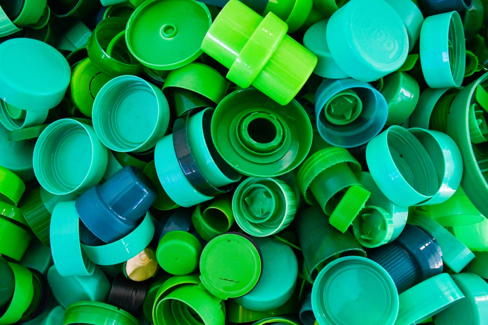
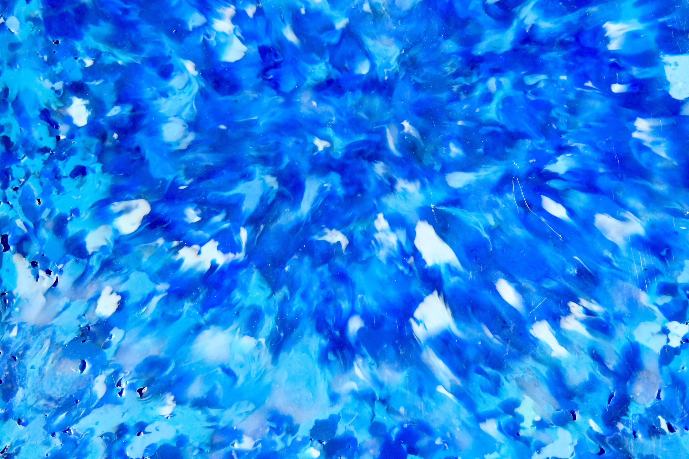
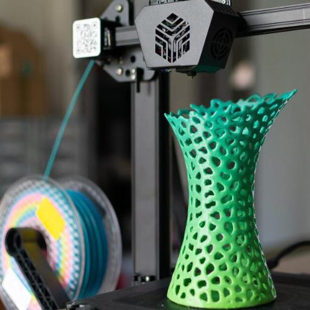
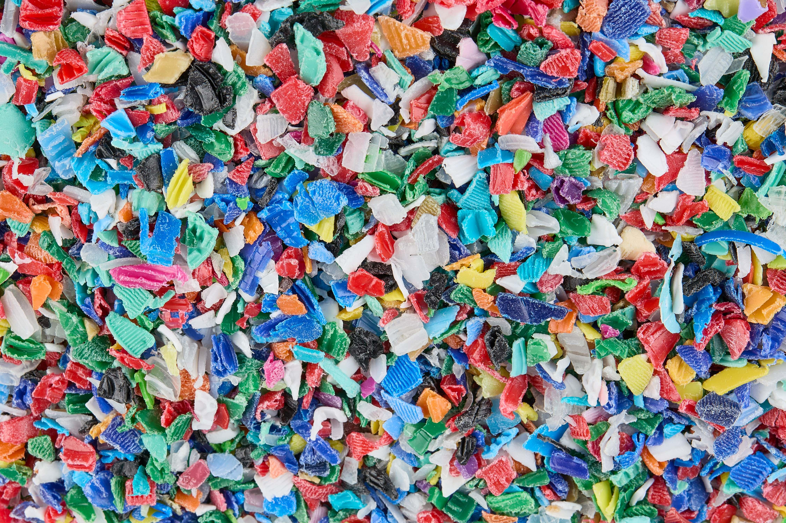
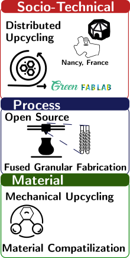
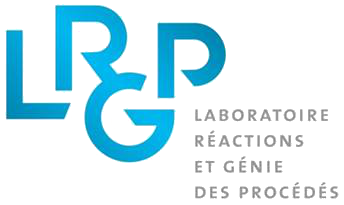
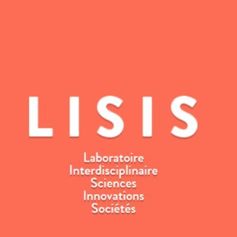

<!-- HERO -->
:::{.hero-section .column-screen}
:::{.hero-content}

[RESEARCH · MATERIALS · CIRCULARITY]{.eyebrow}

# Turning plastic waste into tomorrow's   materials.

Exploring distributed upcycling of mixed plastic waste through open-source additive manufacturing.

:::{.hero-buttons}

[Discover the project →](research/){.btn-primary}

[Explore our research ↓](research/){.btn-secondary}

:::
:::
:::

  

[OUR AIM]{.eyebrow}

## From waste to new [possibilities]{style="color: green;"}

Our overall research aims is to study, implement, and evaluate the ***upcycling potential*** of mixed plastic waste via in-situ reactive compatibilization using **open-source additive manufacturing**.

::: {.grid .process-section}

::: {.g-col-12 .g-col-md-3 .process-card}

{alt="Mixed plastic waste"}
[01]{.step-number}

### Mixed plastic waste
Give a new purpose to post-consumer plastics.

:::

::: {.g-col-12 .g-col-md-3 .process-card}

{alt="Mixed plastic waste"}
[02]{.step-number}

### Reactive compatibilization

Enhance the properties of mixed plastic blends.

:::

::: {.g-col-12 .g-col-md-3 .process-card}

{alt="Mixed plastic waste"}
[03]{.step-number}

### Open-source 3D printing
Give a new purpose to post-consumer plastics.

:::

::: {.g-col-12 .g-col-md-3 .process-card}

{alt="Mixed plastic waste"}
[04]{.step-number}

### Socio-technical
Give a new purpose to post-consumer plastics.

:::

:::

::: {.grid .align-items-center }

::: {.g-col-12 .g-col-md-7 }

[OUR APPRAOCH]{.eyebrow}

## Multi-level perspective of the [Distributed Upcycling]{fg="orange"}

Our overall research aims is to study, implement, and evaluate the ***upcycling potential*** of mixed plastic waste via in-situ reactive compatibilization using **open-source additive manufacturing**.

UP3DCYCLING project is supported by multidisciplinary expertise spanning three domains: 1) polymer science, 2) additive manufacturing processes, and 3) socio-technical systems.
The interaction across these three levels is supported by experimental, modeling, and scenario approaches, which constitute a key added value of the project, enabling a holistic understanding of both technical and social dynamics.

:::

::: {.g-col-12 .g-col-md-5 }

{width="100%" fig-align="center"}

:::

:::

## Latest project [News]{fg="green"}

:::: {.grid}

::: {.g-col-4}

#### News

::: {#news}

:::
[More details &rarr;](news/){.btn-primary}
:::

::: {.g-col-4}

<!-- #### Dissemination Activities -->

<!-- ::: {#project}

::: -->

:::

::: {.g-col-4}

<!-- #### Publications
::: {#publication}

::: -->

:::
::::

# Our Academical Allies {style="text-align: center"}

::: {.grid .align-items-center .column-screen-inset}

::: {.g-col-1}

:::

::: {.g-col-2}
{width="85%" fig-align="center"}
:::

::: {.g-col-2}
{width="85%" fig-align="center"}
:::

::: {.g-col-2}
{width="85%" fig-align="center"}
:::

::: {.g-col-2}
{width="75%" fig-align="center"}
:::

::: {.g-col-2}
{width="100%" fig-align="center"}
:::

::: 

# Our Societal Allies {.title-block style="text-align: center"}

::: {.grid .align-items-center }

::: {.g-col-3 .g-start-2}
{width="85%" fig-align="center"}
:::

::: {.g-col-3 .g-start-5}
{width="85%" fig-align="center"}
:::

::: 

