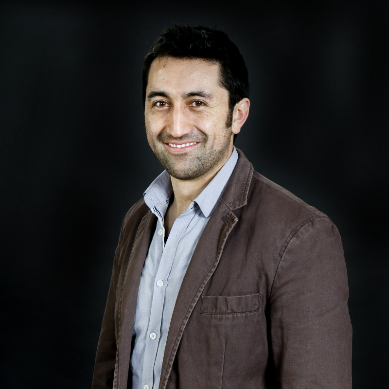
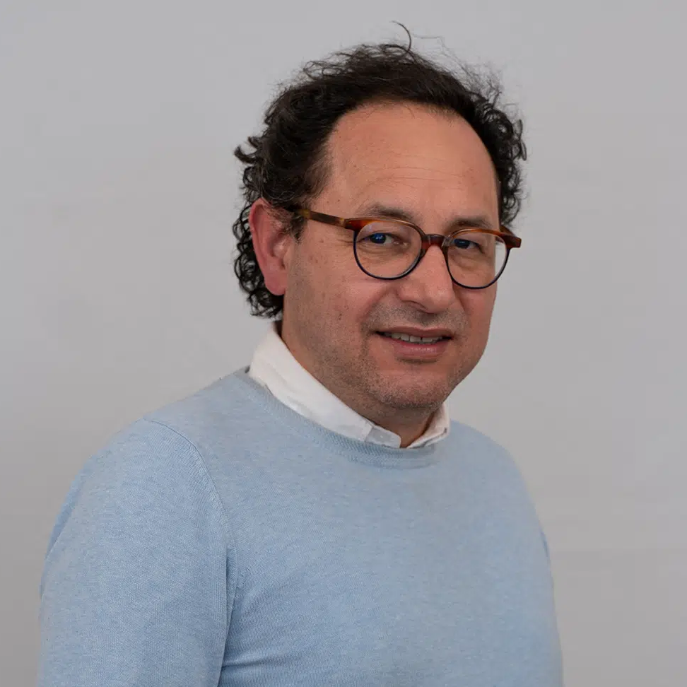
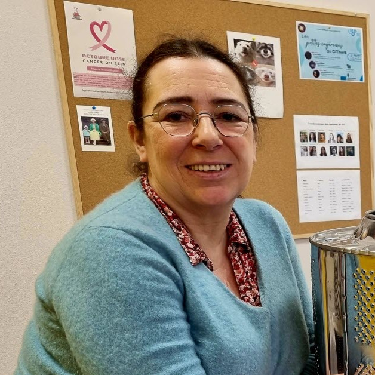
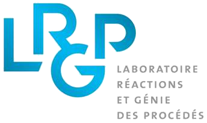
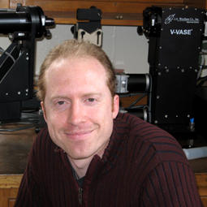
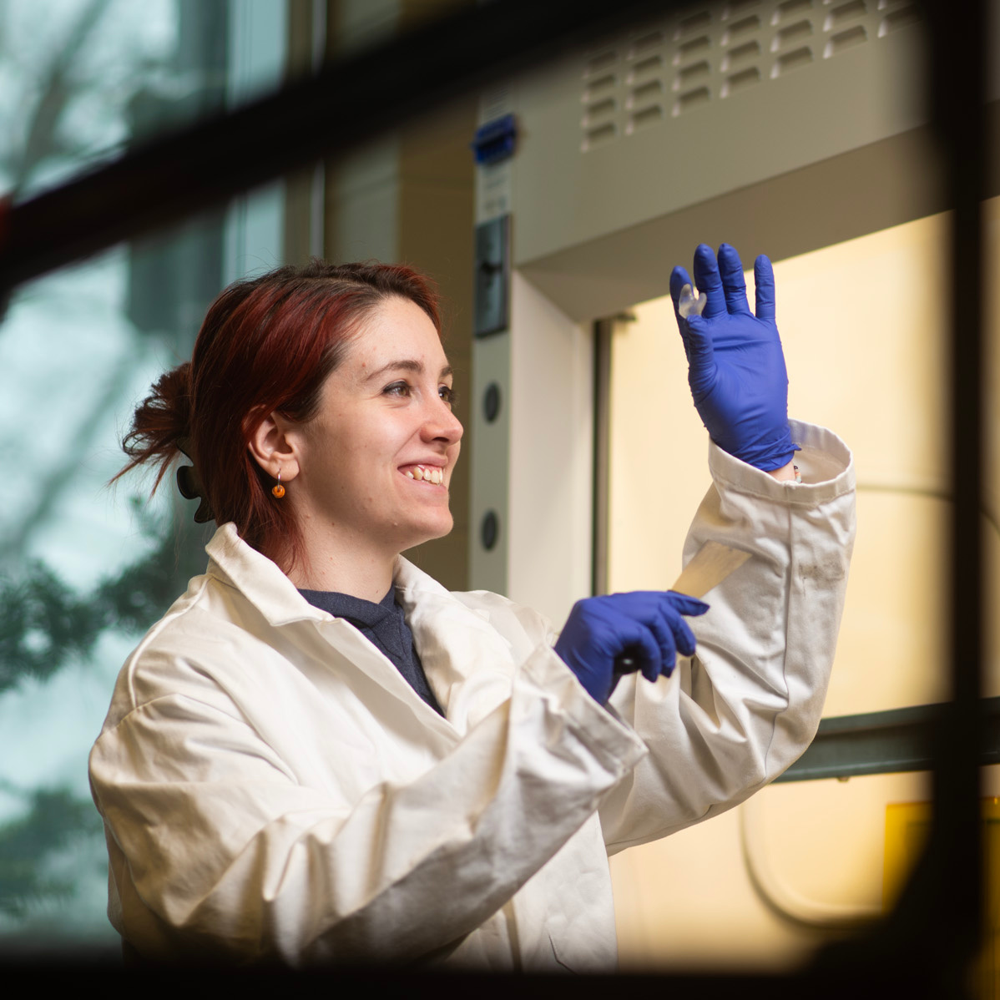
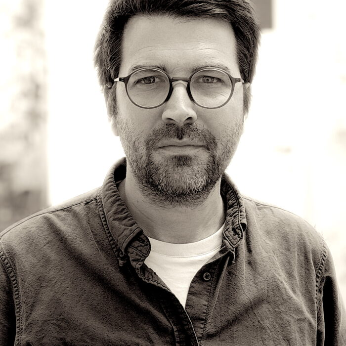
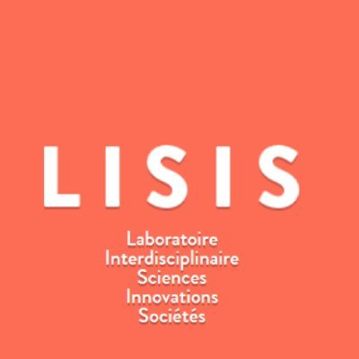

## Équipe de Recherche sur le Processus Innovatifs (ERPI) - Université de Lorraine

::: {.grid .align-items-center }

::: {.g-col-8 }

:::{.grid .align-items-center }
::: {.g-col-2 .people}
{width="100%" fig-align="center" }
:::
::: {.g-col-10}
UP3DCYCLING is coordinated by Associate Professor (Maître de conférences) [](https://orcid.org/0000-0001-8529-5327) Fabio A. Cruz Sanchez. 
He works at the École Nationale Supérieure en Génie des Systèmes et de l’Innovation (ENSGSI) and a researcher at the ERPI Laboratory (Équipe de Recherche sur les Processus Innovatifs), Université de Lorraine, Nancy, France. His research focuses on distributed recycling through additive manufacturing (DRAM), open-source manufacturing technologies and the development of sustainable production systems based on circular economy principles. His main research interests include plastic and polymer recycling, 3D printing and additive manufacturing, open-source hardware, distributed manufacturing networks, and the technical, logistical and environmental assessment of recycling processes. He also investigates the role of FabLabs and collaborative innovation spaces in enabling local recycling initiatives, closing material loops and promoting socio-technical transitions towards more sustainable and decentralized manufacturing systems.
:::
::: {.g-col-2 .people}
{width="100%" fig-align="center" .people}
:::

::: {.g-col-10}
Mauricio Camargo is a Professor of Technology and Innovation Management at the École Nationale Supérieure en Génie des Systèmes et de l’Innovation (ENSGSI), Université de Lorraine, in Nancy, France, and Director of the ERPI Laboratory (Research Team on Innovative Processes). His research focuses on innovation engineering and the management, design and evaluation of innovation processes. His main research interests include new product development, decision-making in product and process design, technology and innovation management, and multi-criteria and multi-objective decision-support methods. He also investigates collaborative and interdisciplinary approaches to innovation, including Open Innovation and Living Labs, as well as the development of methodologies and tools to support innovation strategies and the sustainable transformation of industrial and organizational systems
:::

::: {.g-col-2 .people}
{width="100%" fig-align="center" .people}
:::

::: {.g-col-10}
Hakim Boudaoud is a Professor at the École Nationale Supérieure en Génie des Systèmes et de l’Innovation (ENSGSI) and a researcher at the ERPI Laboratory (Équipe de Recherche sur les Processus Innovatifs) at Université de Lorraine, Nancy, France. His research focuses on mechanical engineering, additive manufacturing and the development of innovative and sustainable materials and production processes. His main research interests include polymer recycling and circular economy, open-source and distributed additive manufacturing, mechanical characterization and modelling of materials, and the optimization of 3D-printing processes. He also investigates the potential of open-source hardware and decentralized manufacturing technologies to support local recycling initiatives, reduce environmental impacts and promote more sustainable production systems.

:::

:::
:::

::: {.g-col-4}
{width="85%" fig-align="center" .people}
:::

:::

---

## Laboratoire Réactions et Génie des Procédés -- Université de Lorraine

::: {.grid .align-items-center }

::: {.g-col-8 }

:::{.grid .align-items-center .people}

::: {.g-col-2 }
{width="100%" fig-align="center" }
:::

::: {.g-col-10}
Cécile Nouvel is a Professor at the École Nationale Supérieure des Industries Chimiques (ENSIC) and a researcher at the Laboratoire Réactions et Génie des Procédés (LRGP). Her research focuses on polymer product engineering, particularly the design, formulation, processing and characterization of functional polymeric materials. Her main research interests include the synthesis and development of functional (co)polymers, polymer emulsifiers and nanoemulsions, polymer processing by extrusion and 3D printing, and the development of advanced materials for biomedical applications and drug delivery. More recently, her research also addresses sustainable polymer materials, including recycling and innovative processing strategies to improve material performance and recyclability.
:::

::: {.g-col-2 .people}
{width="100%" fig-align="center" .people}
:::

::: {.g-col-10}
Sandrine Hoppe is a CNRS researcher at the Laboratoire Réactions et Génie des Procédés (LRGP) in Nancy, France. Her research focuses on the development, processing and characterization of polymeric materials with controlled properties and structures. Her main research interests include polymer processing and reactive extrusion, micro- and nanostructured polymer composites, bio-based and sustainable materials, and the valorization and recycling of plastics. She also works on process modelling, simulation and optimization, with the aim of developing innovative and more sustainable materials and manufacturing processes
:::

:::
:::

::: {.g-col-4 }
{width="85%" fig-align="center"}
:::
:::

---

## Free Appropriate Sustainable Technology (FAST) -- Western University

::: {.grid .align-items-center }

::: {.g-col-8 }
:::{.grid .align-items-center .people}
::: {.g-col-2 }
{width="250px" fig-align="center" .people}
:::

::: {.g-col-10}
Joshua Pearce is the director of the [Free Appropriate Sustainability Technology research group -- https://www.appropedia.org/FAST](https://www.appropedia.org/FAST) at the Western University, which is recognized as one of world’s top 20 universities in new global sustainability rankings top 20 ranked universities for sustainability.
Prof. Joshua Pearce' research is on the use of open source appropriate technology (OSAT) to find collaborative solutions to problems in sustainability and to reduce poverty. His research spans areas of engineering of solar photovoltaic technology, open hardware, and distributed recycling and additive manufacturing (DRAM) using RepRap 3-D printing, but also includes policy and economics.
:::

::: {.g-col-2  .people}
{width="250px" fig-align="center" }
:::

::: {.g-col-10}
Alessia Romani is  a Western Postdoctoral Fellowship Awardee and Postdoctoral Associate at FAST Lab, Western University (Canada). Her work lies at the intersection of product and engineering design, materials, digital fabrication, and sustainability, with a focus on circular practices and open design. Her research experience and background merge materials engineering with product and engineering design, developing and characterising sustainable materials for design and 3D printing, and keeping a hands-on and application-driven approach.
:::

:::
:::

::: {.g-col-4 }
{width="250px" fig-align="center"}
:::
:::

---

## Laboratoire Interdisciplinaire Sciences Innovations Sociétés

::: {.grid .align-items-center }

::: {.g-col-8 }
:::{.grid .align-items-center .people}
::: {.g-col-2 }
{width="250px" fig-align="center" .people}
:::

::: {.g-col-10}
Baptiste Monsaingeon is a sociologist specializing in science, technology, and the environment. A lecturer at the University of Reims Champagne-Ardenne, he is currently on secondment as a research fellow at the CNRS, within the LISIS. His research focuses on analyzing the relationships between contemporary societies and their waste. Since 2016, he has been particularly interested in plastics, seeking to reconstruct their socio-technical trajectories—both in terms of the history of their production and uses, as well as their impacts and regulation. Between 2022 and 2025, he served as scientific co-leader in charge of the social and human sciences (SHS) for the INRAE and CNRS Collective Scientific Expertise on plastics used in agriculture and food (ESCo Plastiques). In 2024, he received the CNRS Bronze Medal.
:::

:::
:::

::: {.g-col-4 }
{width="250px" fig-align="center"}
:::
:::

