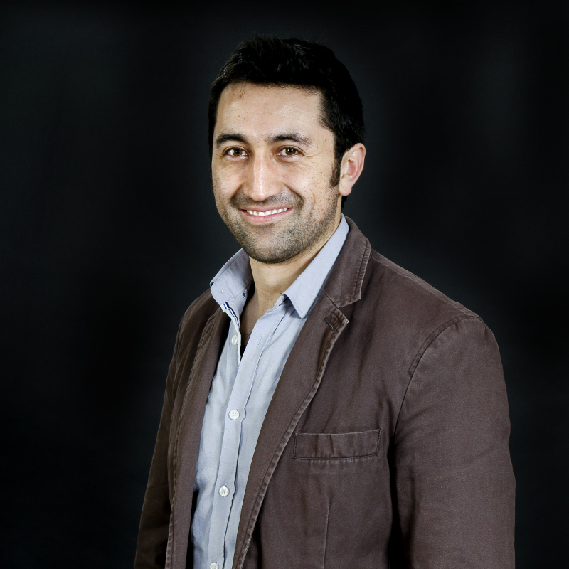
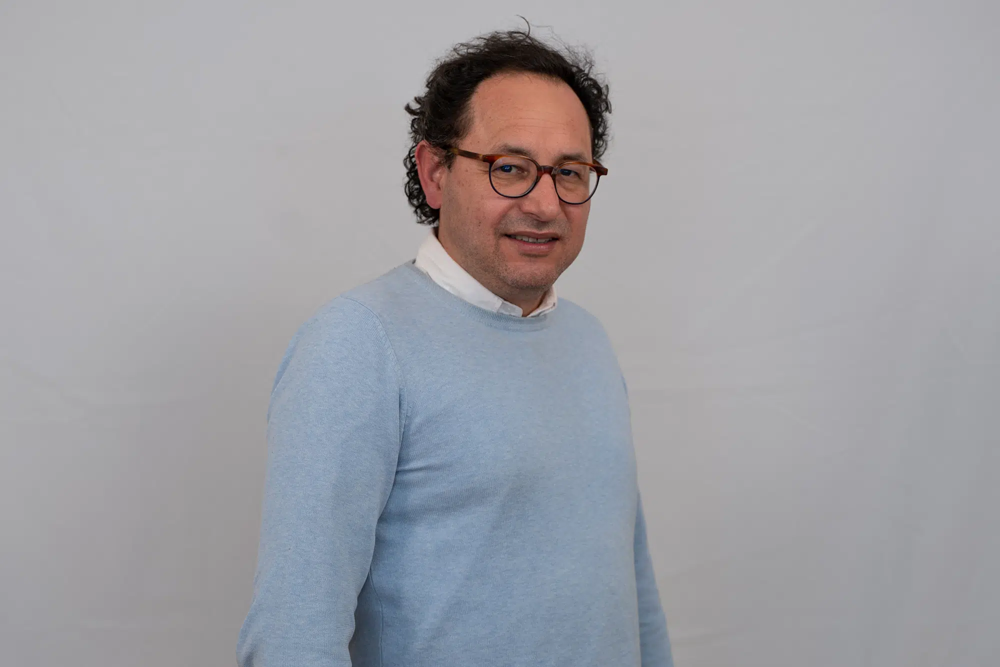
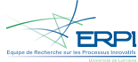
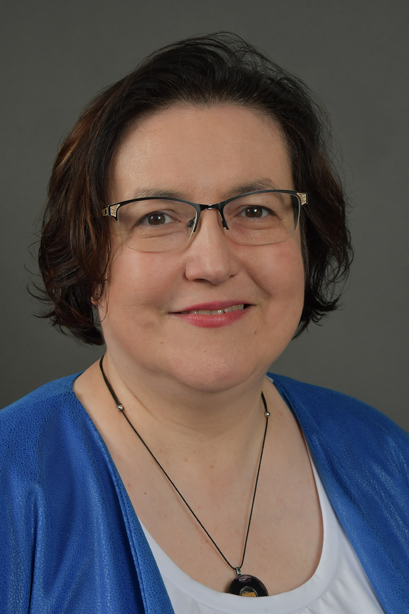
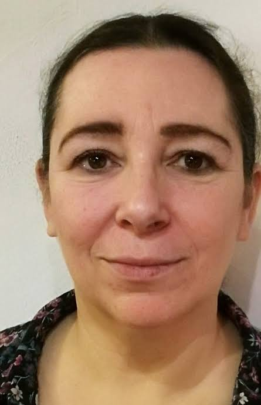
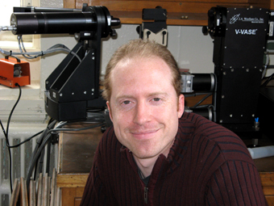
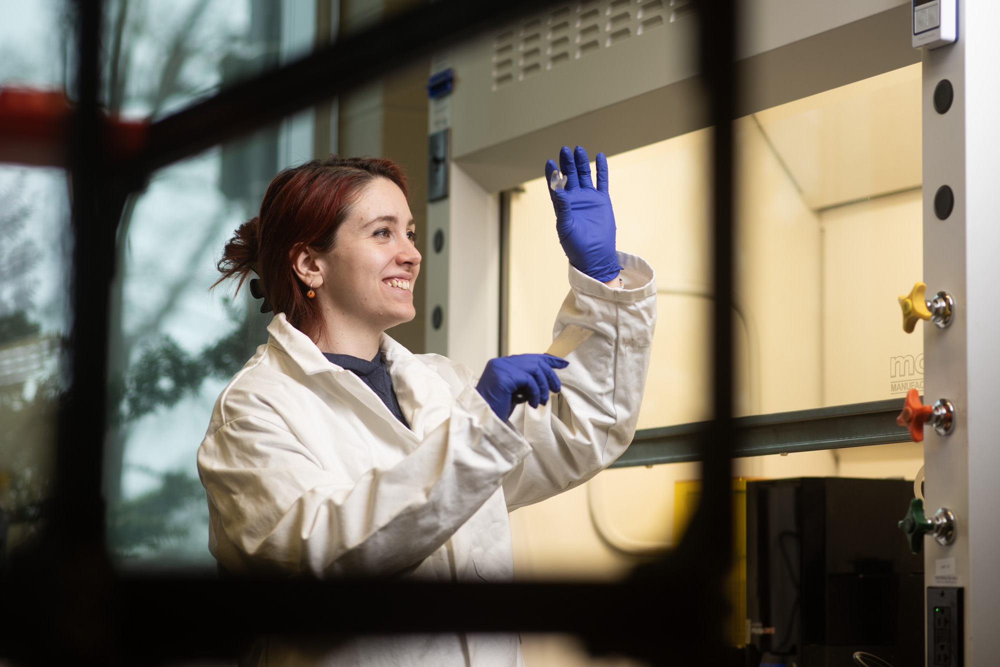
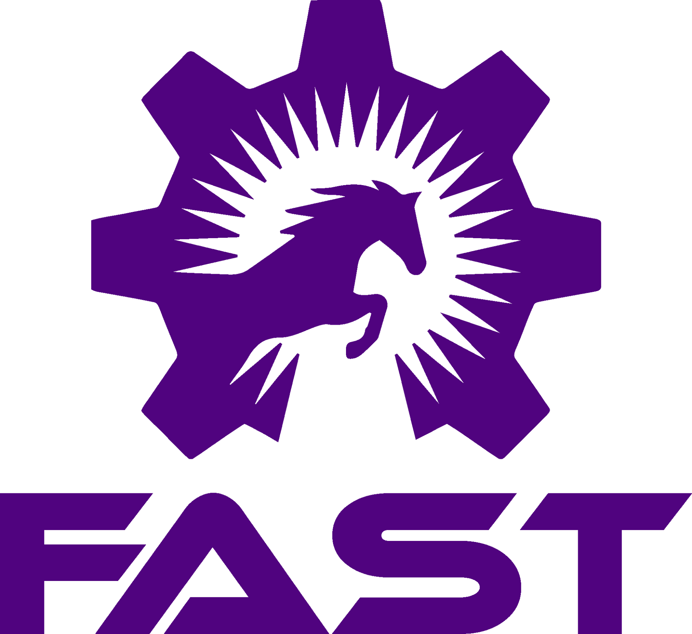

## Équipe de Recherche sur le Processus Innovatifs (ERPI) - Université de Lorraine

::: {.grid .align-items-center }

::: {.g-col-8 }

:::{.grid .align-items-center }
::: {.g-col-2 }
{width="100%" fig-align="center"}
:::
::: {.g-col-10}
UP3DCYCLING is coordinated by MCF Fabio A. Cruz Sanchez  
(\orcidlink{0000-0001-8529-5327} [https://orcid.org/0000-0001-8529-5327](https://orcid.org/0000-0001-8529-5327)). 
He is an Assistant Professor (MCF) in Mechanical Engineering at Université de Lorraine / ERPI (EA 3767). 
:::
::: {.g-col-2 }
{width="100%" fig-align="center"}
:::

::: {.g-col-10}
Mauricio Camargo
:::

::: {.g-col-2 }
{width="100%" fig-align="center"}
:::

::: {.g-col-10}
Hakim Boudaoud

:::

:::
:::

::: {.g-col-4}
{width="85%" fig-align="center"}
:::

:::

---

::: {.grid .align-items-center }

::: {.g-col-8 }
:::{.grid .align-items-center }
::: {.g-col-2 }
{width="100%" fig-align="center"}
:::

::: {.g-col-10}
Cecile Nouvel
:::

::: {.g-col-2 }
{width="100%" fig-align="center"}
:::

::: {.g-col-10}
Sandrine Hoppe
:::

:::
:::

::: {.g-col-4 }
{width="85%" fig-align="center"}
:::
:::

---

::: {.grid .align-items-center }

::: {.g-col-8 }
:::{.grid .align-items-center }
::: {.g-col-2 }
{width="250px" fig-align="center"}
:::

::: {.g-col-10}
Joshua Pearce is the Free Appropriate Sustainability Technology research group, which is housed in one of the Western recognized as one of world’s top 20 universities in new global sustainability rankings top 20 ranked universities for sustainability.

the John M. Thompson Chair in Information Technology and Innovation at the Thompson Centre for Engineering Leadership & Innovation in the Ivey Business School and the Department of Electrical & Computer Engineering at Western University in Canada, a top 1% global university and top 1% in sustainability. I currently I also am on the graduate faculty in the Department of Mechanical & Materials Engineering. I am an adjunct professor Michigan Tech until 2027 where I ran the Michigan Open Sustainability Technology (MOST) research group and was also at Queens University, Canada where I ran the Queens Applied Sustainability Group
:::

::: {.g-col-2 }
{width="250px" fig-align="center"}
:::

::: {.g-col-10}
Alessia Romani is  a Western Postdoctoral Fellowship Awardee and Postdoctoral Associate at FAST Lab, Western University (Canada). Her work lies at the intersection of product and engineering design, materials, digital fabrication, and sustainability, with a focus on circular practices and open design. My research experience and background merge materials engineering with product and engineering design, developing and characterising sustainable materials for design and 3D printing, and keeping a hands-on and application-driven approach.
:::

:::
:::

::: {.g-col-4 }
{width="250px" fig-align="center"}
:::
:::

