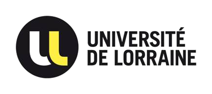
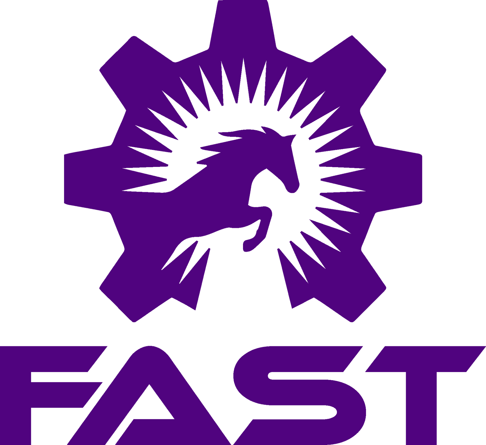

# Équipe de Recherche sur le Processus Innovatifs (ERPI) - Université de Lorraine

## Researchers Team

::: {.column-margin}
[{width="80%"}](https://erpi.univ-lorraine.fr/)

[{width="80%"}](https://erpi.univ-lorraine.fr/){target="_blank"}
:::

:::{#erpi}

:::

# Laboratoire Réactions et Génie des Procédés -- Université de Lorraine

::: {.column-margin}
[{width="80%"}](https://erpi.univ-lorraine.fr/)

[{width="80%"}](https://lrgp-nancy.cnrs.fr/){target="_blank"}
:::

:::{#lrgp}

:::

---

# Free Appropriate Sustainable Technology (FAST) -- Western University

::: {.column-margin}
[{width="250px" fig-align="center"}](https://www.appropedia.org/FAST){target="_blank"}
:::

::: {#fast}
:::

---

# Laboratoire Interdisciplinaire Sciences Innovations Sociétés

::: {.column-margin}
[{width="250px" fig-align="center"}](https://umr-lisis.fr/membre/baptiste-monsaingeon/){target="_blank"}
:::

::: {#lisis}
:::

---

# Universidad Santiago de Chile -- USACH

::: {.column-margin}
[{width="250px" fig-align="center"}](){target="_blank"}
:::

::: {#usach}
:::

