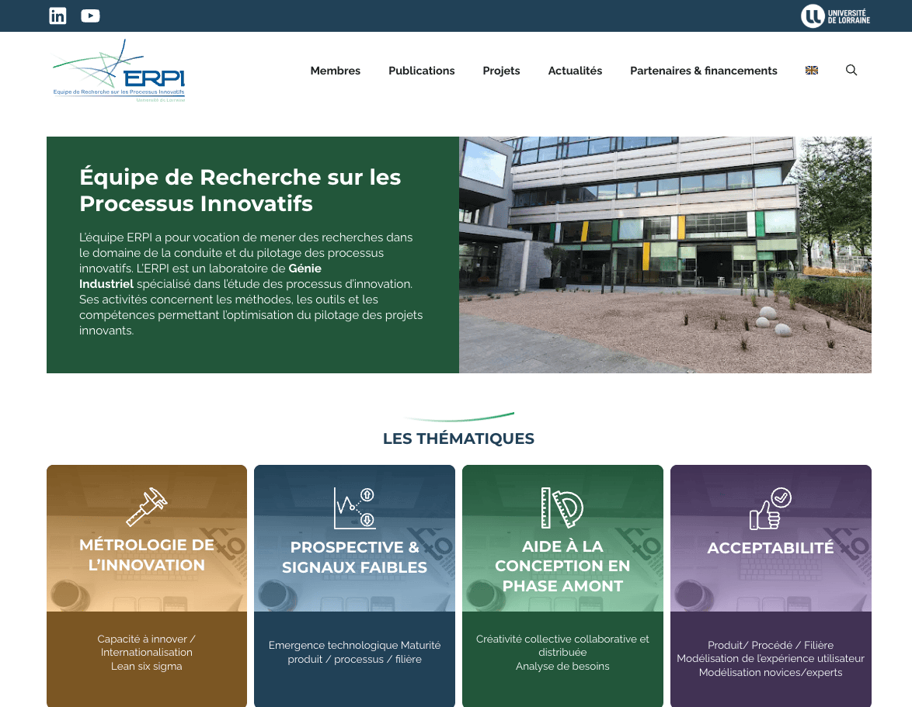
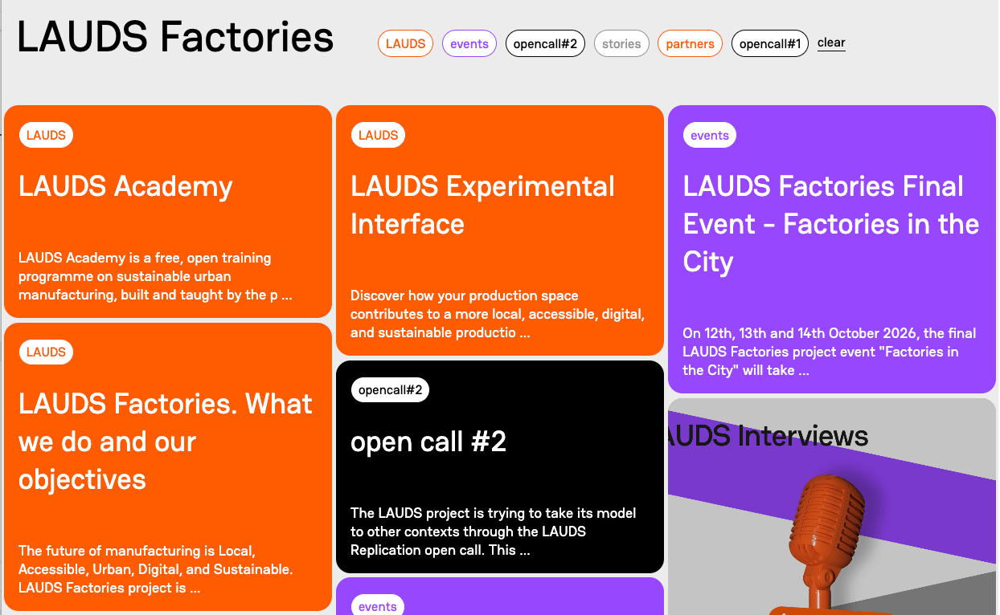
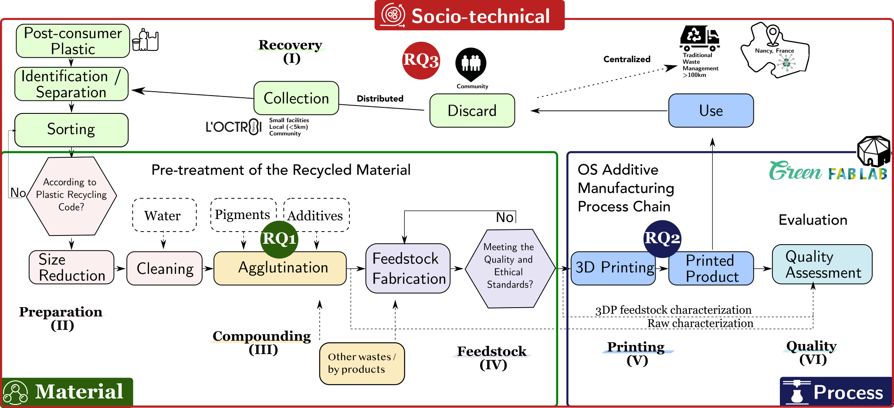
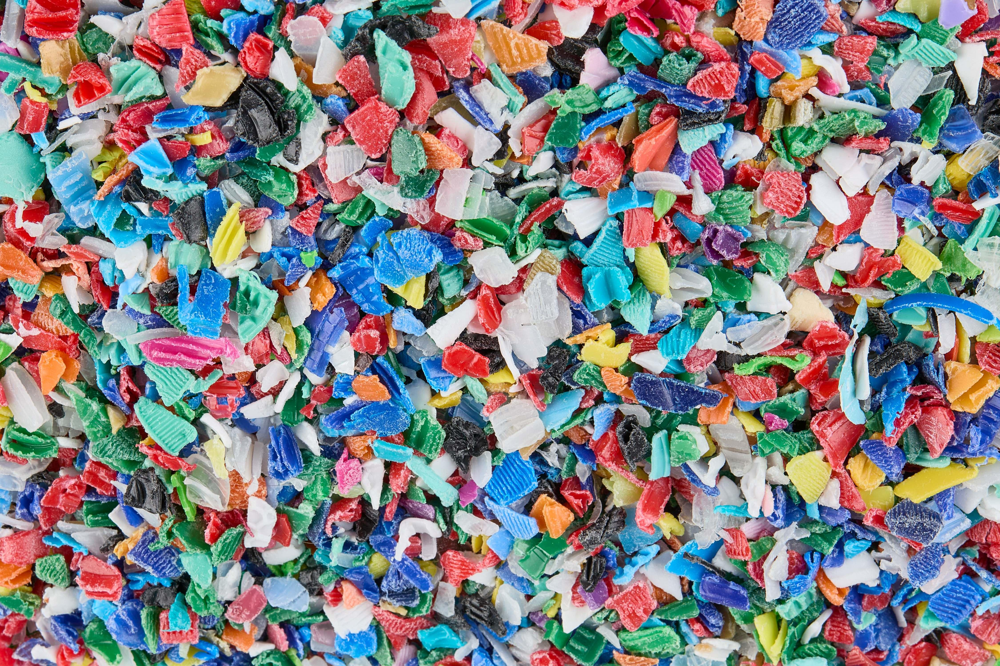
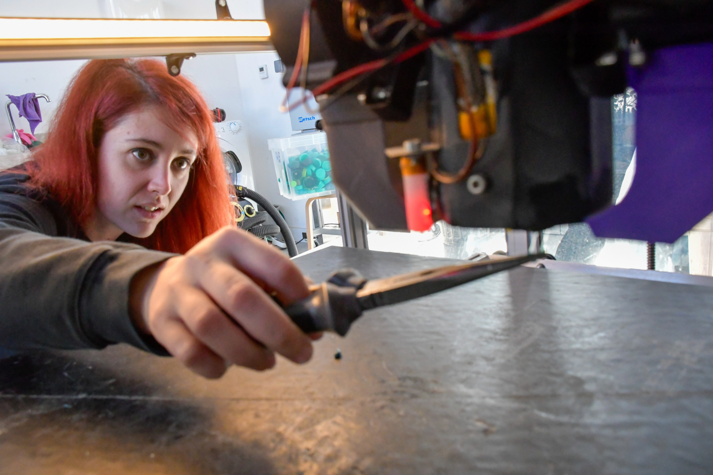
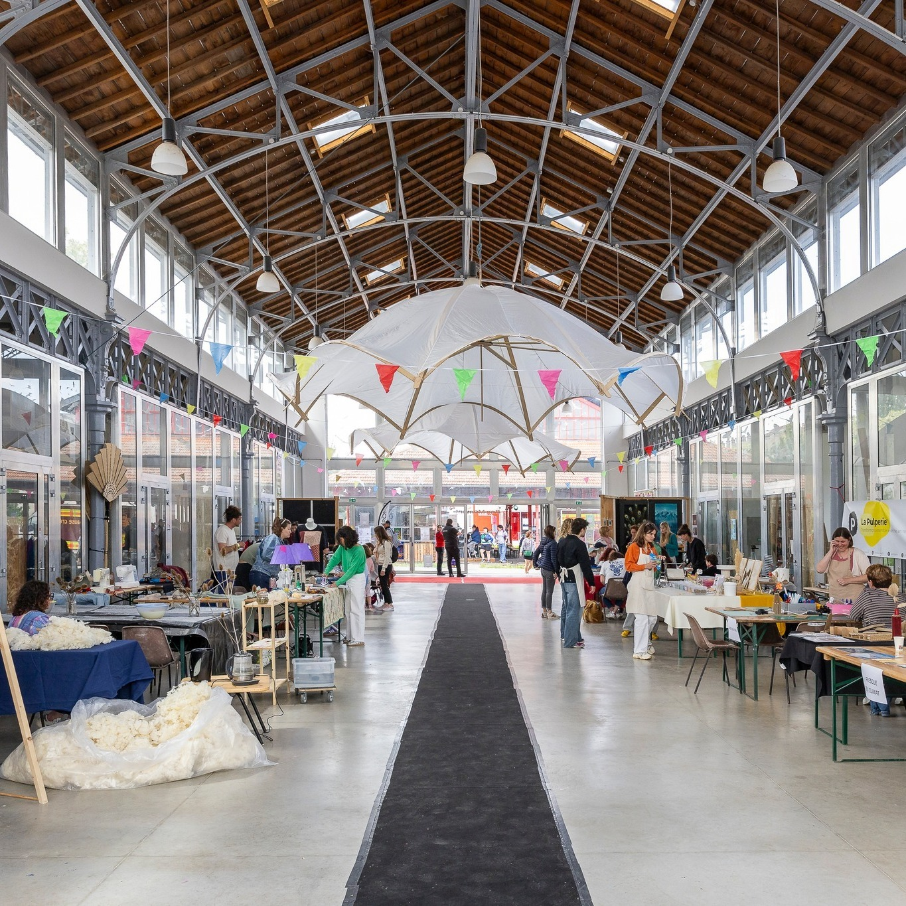

# Motivation

::: {.column-margin}


Voir le site web de l'ERPI

[{width="80%"}](https://erpi.univ-lorraine.fr/){target="_blank"}
:::

Au laboratoire ERPI ([https://erpi.univ-lorraine.fr/](https://erpi.univ-lorraine.fr/)) de l'Université de Lorraine, l'un des principaux axes de recherche porte sur le développement de méthodologies, d'outils et d'études de cas dans le domaine du management des processus d'innovation.
À partir de perspectives relevant de l'ingénierie, du design et des territoires, le laboratoire développe des recherches à l'intersection de la fabrication additive, de l'économie circulaire et de la fabrication urbaine.

L'un des axes de recherche se situe au croisement de trois grands enjeux sociétaux :

1. L'économie circulaire des plastiques comme paradigme de rupture sur les plans politique, industriel et sociétal [@depascale2023; @ramli2024] ;

2. Le développement de la conception ouverte (*open design*) [@bakirlioglu2019; @pacheco2025], incluant les technologies open source comme alternative aux approches traditionnelles de développement technologique ;

3. Le développement expérimental d'approches de fabrication urbaine [@herrmann2020; @ijassi2025] (FabLabs, tiers-lieux, recycleries et matériauthèques), généralement issues d'initiatives citoyennes de terrain. Ces approches reconfigurent les réseaux de production à l'échelle locale et ouvrent de nouvelles perspectives pour les processus d'éco-innovation au service de l'économie circulaire [@kasmi2021a].

:::{.column-margin}
Voir, par exemple, le projet européen LAUDS Factories
[{width="80%"}](https://lauds.eu/#archive){target="_blank"}
:::

En effet, les systèmes centralisés actuels de gestion des déchets demeurent structurellement inadaptés [@lerpiniere2025] pour répondre à la nature complexe et systémique de la pollution plastique, une crise qui menace de plus en plus les limites planétaires [@villarrubia-gomez2024] et l'espace de fonctionnement sûr pour l'humanité.

Dans ce contexte, le laboratoire ERPI développe le concept de « *recyclage distribué par fabrication additive (DRAM, Distributed Recycling via Additive Manufacturing)* » [@cruzsanchez2020], illustré à la @fig-dram.
Cette approche porte sur la faisabilité technique de l'intégration des plastiques recyclés dans la chaîne de procédés de fabrication additive, notamment à travers les systèmes fondés sur l'extrusion de matière, qui sont les plus répandus dans l'industrie et auprès du grand public.

{#fig-dram fig-alt="Schéma du recyclage distribué par fabrication additive" width="85%"}

La phase de **Collecte (I)** concerne les opérations logistiques nécessaires à la collecte des déchets plastiques en vue de leur réutilisation dans les systèmes DRAM.
La phase de **Préparation (II)** comprend l'identification, la séparation, le tri, la réduction granulométrique et le nettoyage des déchets plastiques afin de garantir une qualité suffisante.
La phase de **Formulation (III)** (*compounding*) porte sur le développement de matériaux monoconstituants et composites.
La phase de **Production de matière première (IV)** consiste ensuite à produire des matériaux adaptés à l'impression, sous forme de filaments pour la FFF ou de particules pour la FGF.
La phase d'**Impression (V)** concerne le développement d'applications et l'optimisation des procédés pour les matériaux recyclés.
Enfin, la phase de **Qualité (VI)** repose sur la caractérisation technique à plusieurs niveaux des matériaux recyclés et des pièces imprimées.

Ainsi, trois grandes échelles sont étudiées simultanément, comme l'illustre la @fig-dram :

- **À l'échelle du matériau** : étude des stratégies de recyclage et de surcyclage des plastiques post-consommation afin d'améliorer les propriétés structurales des déchets plastiques.
- **À l'échelle du procédé** : les équipements open source (fabrication additive, injection manuelle, presses à plaques, etc.) constituent une voie prometteuse pour transformer les déchets plastiques en objets et produits utilisables.
- **À l'échelle sociotechnique** : les systèmes de fabrication urbaine peuvent offrir un environnement favorable au surcyclage distribué, en permettant la transformation des déchets plastiques en produits répondant aux besoins locaux, au plus près de leur lieu de production.

Par exemple, en utilisant des systèmes de fabrication par dépôt de filament fondu (FFF, *Fused Filament Fabrication*) [@cruzsanchez2014] et de fabrication par extrusion de granulés fondus (FGF, *Fused Granular Fabrication*) [@alexandre2020] à l'échelle de machines de bureau, nous avons démontré leur potentiel en tant que leviers techniques pour le recyclage mécanique de déchets constitués d'un seul type de thermoplastique, comme l'acide polylactique (PLA), selon des perspectives relevant du *matériau* [@cruz2015; @cruzsanchez2017], du *procédé* [@cruzsanchez2014; @alexandre2020] et des *systèmes sociotechniques* [@santander2020; @caceres-mendoza2023].
Plus récemment, les travaux sur les mélanges multimatériaux [@suescungonzalez2024; @gonzalez2025] ont ouvert de nouvelles pistes exploratoires visant à étudier le potentiel de *surcyclage* [@riondet2022] de cette approche.

:::{.column-page-right}

## La compatibilisation des matériaux comme stratégie de surcyclage

::: {.grid .align-items-center }

::: {.g-col-8}

L'incompatibilité entre les différents types de plastiques, liée aux différences de leurs structures chimiques et moléculaires, demeure un obstacle majeur, entraînant une faible adhésion interfaciale et des performances limitées des matériaux [@kassab2023].
L'objectif d'*UP3DCYCLING* est de développer pleinement une stratégie de surcyclage ciblant les plastiques triés mais non recyclés, faute de chaînes de valeur viables.

Dans cette perspective, notre mission consiste à étudier le surcyclage mécanique des déchets plastiques en mélange par l'incorporation d'agents compatibilisants lors du processus de fusion.
Le principal résultat attendu est une étude comparative approfondie des stratégies de compatibilisation appliquées aux six principaux plastiques à usage unique : le polyéthylène téréphtalate (PET), le polyéthylène haute densité (PEHD), le polypropylène (PP), le polyéthylène basse densité (PEBD), le polystyrène (PS) et l'acide polylactique (PLA).

L'ambition est d'établir un cadre systématique définissant les exigences minimales de qualité pour la fabrication additive à partir de mélanges de matériaux recyclés, un domaine encore insuffisamment exploré par la recherche actuelle.

:::

::: {.g-col-4}

{width="85%"}

:::

:::

:::

---

## La fabrication par extrusion de granulés fondus open source : une technologie prometteuse pour le surcyclage distribué

::: {.grid .align-items-center }

::: {.g-col-8}

L'utilisation de la fabrication additive open source (également appelée *impression 3D*) révolutionne la manière dont les plastiques peuvent être mis en œuvre et transformés.
Malgré le potentiel considérable de la fabrication additive en tant que mode de production avancé pour l'avenir, des défis fondamentaux en matière de durabilité restent à relever.

Notre objectif porte sur l'instrumentation, l'adaptation et l'évaluation comparative d'un système open source de fabrication par extrusion de granulés fondus (FGF) [@gonzalez2025], capable de traiter des mélanges hétérogènes de déchets.
Il s'agit d'optimiser le procédé FGF pour les mélanges multimatériaux, en intégrant un suivi en temps réel et une commande en boucle fermée afin d'améliorer la qualité et la fiabilité de l'impression.
:::

::: {.g-col-4}
{width="85%"}
:::
:::

---

:::{.column-page-left}

## La fabrication urbaine comme milieu sociotechnique propice au surcyclage distribué

::: {.grid .align-items-center }

::: {.g-col-4}
{width="85%"}
:::
::: {.g-col-8}

**UP3DCYCLING** vise à explorer le surcyclage distribué dans une perspective de conception pour la durabilité (DfS, *Design for Sustainability*) [@ceschin2019], en mettant l'accent sur ses implications sociotechniques.
Le projet adoptera une approche mixte, qualitative et quantitative, pour analyser les systèmes urbains de surcyclage.
Les implications plus larges du surcyclage distribué en tant que transition vers la durabilité restent insuffisamment comprises [@eising-mertsch2024].

Une démarche de recherche-action participative sera mise en œuvre à travers une étude de cas en conditions réelles au sein du « Green Fablab » à Nancy [https://erpi.univ-lorraine.fr/projet/green-fablab/](https://erpi.univ-lorraine.fr/projet/green-fablab/), développé depuis 2017 en étroite collaboration avec les acteurs locaux, notamment au sein du tiers-lieu associatif Octroi Nancy [https://www.octroi-nancy.fr/](https://www.octroi-nancy.fr/).
Dans ce cadre, nous concevrons et déploierons une chaîne intégrée permettant de collecter, nettoyer, trier, broyer et transformer les déchets plastiques post-consommation en nouveaux produits par fabrication additive, favorisant ainsi la valorisation locale de matériaux actuellement exclus des systèmes conventionnels de recyclage [@cruzsanchez2020; @santander2020; @caceres-mendoza2023].
:::
:::
