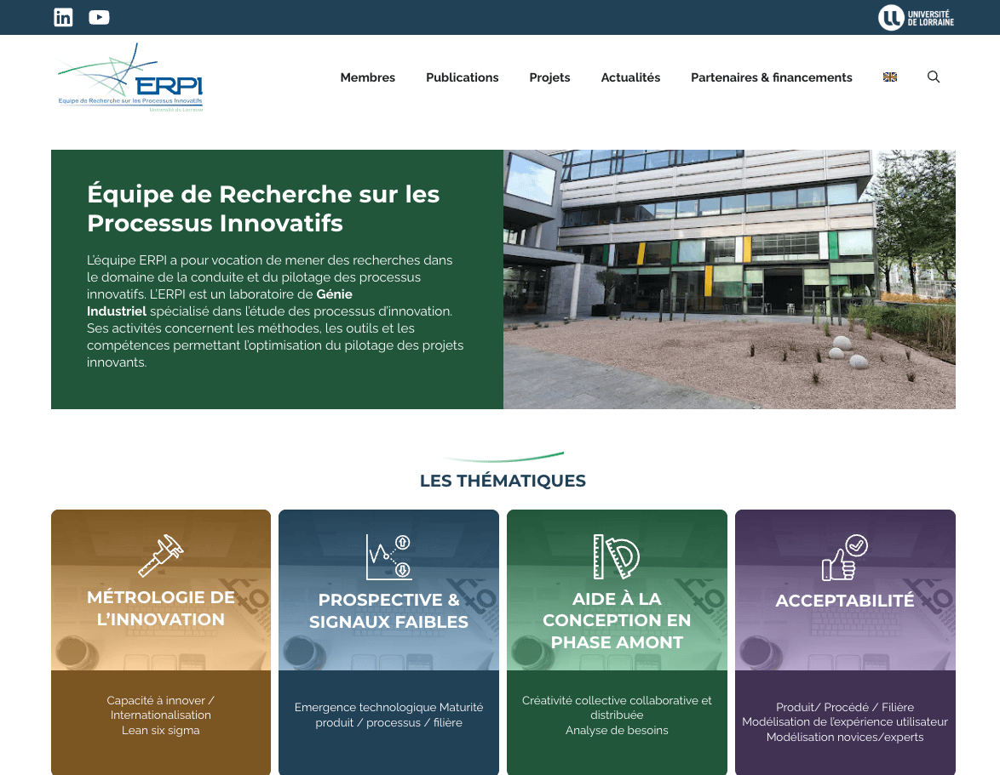
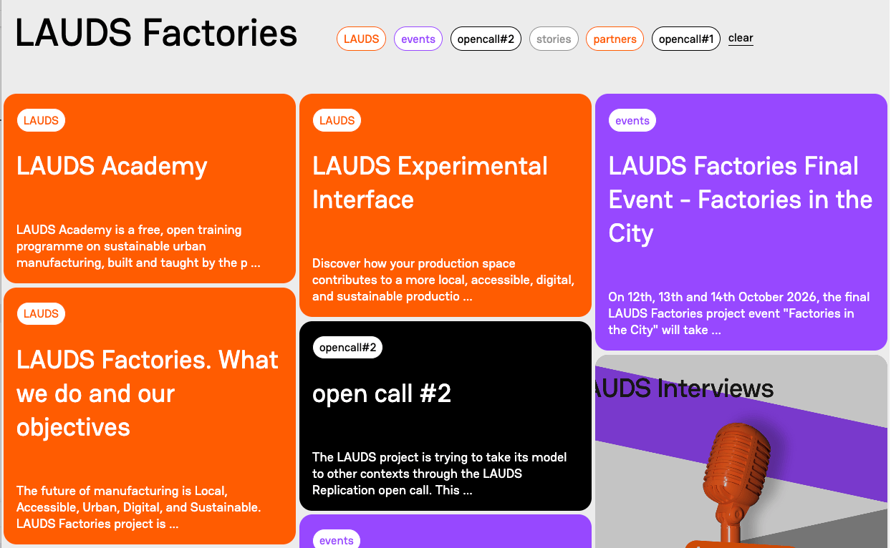
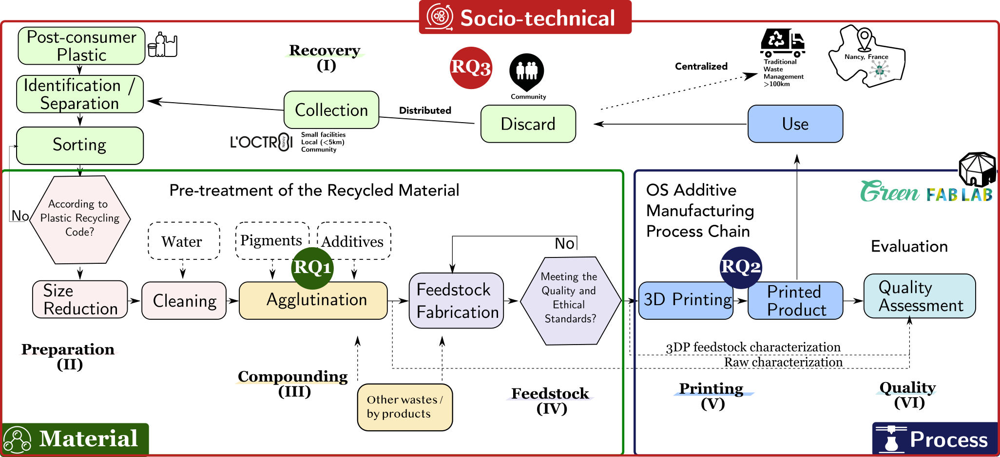

# Motivation 

::: {.column-margin}


See on the Website of ERPI

[{width="80%"}](https://erpi.univ-lorraine.fr/){target="_blank"}
:::
At the ERPI laboratory ([https://erpi.univ-lorraine.fr/](https://erpi.univ-lorraine.fr/)) of the Universiré de Lorraine, one major interest is the the development of methodologies, tools and  case studies in the area of innovation process management. 
From engineering and design and territorial perspectives, the laboratory has been developing research on the intersection of additive manufacturing, circular economy and urban manufacturing. 

One of the research axis concerns the intersection on three major societal issues as follows:

1. The circular economy of plastics as disruptor paradigm in political, industrial and societal perspective [@depascale2023; @ramli2024], 

2. The development of open design [@bakirlioglu2019; @pacheco2025] including the open source technology as alternative approach of traditional technology development and,

3. The experimental development of the urban manufacturing approaches [@herrmann2020; @ijassi2025] (i.e. Fablabs, Tiers Lieux, Recycleries and Matériauthèque) that usually are grassroot mouvements. These approaches are reframing the manufacturing networks at a local level and can give perspective on eco-innovation process for circular economy [@kasmi2021a]. 

:::{.column-margin}
See for instance the LAUDS Factories EU Project 
[{width="80%"}](https://lauds.eu/#archive){target="_blank"} 
:::

Indeed, current centralized waste management systems remain structurally inadequate [@lerpiniere2025] to address the complex and systemic nature of plastic pollution, a crisis that increasingly threatens planetary boundaries [@villarrubia-gomez2024] and the safe operating space for humanity. 

In this regard, ERPI Laboratory have been developing the concept of “*distributed recycling via additive manufacturing (DRAM)*” [@cruzsanchez2020] as illustrated in @fig-dram.
It involves the technical feasibility of using recycled plastics into the additive manufacturing printing process chain.
Particularly, the use systems based on material extrusion which are the most used in industry and general public.

{#fig-dram fig-alt="alt" width="85%"}

The **Recovery (I)** phase addresses the logistical operations required to collect plastic waste for reuse within DRAM systems. 
The **Preparation (II)** phase encompasses the identification, separation, sorting, size reduction, and cleaning of plastic waste to ensure adequate quality. 
The **Compounding (III)** phase focuses on the development of mono- and composite materials.
After, the **Feedstock (IV)** phase focuses on producing materials suitable for printing, either in filament form for FFF or as particles for FGF. 
The **Printing (V)** phase addresses application development and process optimization for recycled materials.
Finally, the **Quality (VI)** phase involves multi-level technical characterization of recycled materials and printed parts.

Therefore, three major scales are simultaneaosly studied, as illustrated in @fig-dram :

- **Material level**:
The study of strategies for post-consumer plastic recycling/upcycling to enhance the structural properties of plastic waste.
- **Process level**: 
Open-source hardware (i.e additive manufacturing, manual injection, sheetpress etc) as a promising pathway to transform plastic waste into usable artifacts/products.
- **Socio-technical level**:
Urban manufacturing systems can provide a conducive environment for distributed upcycling, enabling the transformation of plastic waste into locally relevant products, closer to where the waste is generated. 

For instance, using desktop-scale fused filament fabrication (FFF) [@cruzsanchez2014] and fused granular fabrication (FGF) [@alexandre2020], we have demonstrated their potential as technical enablers for the mechanical recycling of mono-thermoplastic waste, such as polylactic acid (PLA), from *material* [@cruz2015; @cruzsanchez2017], *process* [@cruzsanchez2014; @alexandre2020], and *socio-technical* perspectives [@santander2020; @caceres-mendoza2023]. 
Recently, the work on multi-material [@suescungonzalez2024; @gonzalez2025] 
have openend new explorative paths that aims to see the *upcycling* [@riondet2022] potential of this approach.

:::{.column-page-right}

## Material compatibilization as upcycling strategy

::: {.grid .align-items-center }

::: {.g-col-8}

The incompatibility between different plastic types—due to variations in chemical and molecular structures—remains a major limitation, leading to poor interfacial adhesion and low material performance [@kassab2023]. 

Our aim in *UP3DCYCLING* is to fully develop an upcycling strategy targeting plastics that are sorted but not recycled due to the lack of viable value chains.

 In this sense our mission is to investigate the mechanical upcycling of mixed plastic waste through the incorporation of compatibilizers during the melting process.  
 
 design catalysts but always considering their scalability.
Our main outcome of is a comprehensive benchmarking of compatibilization strategies applied to the six primary single-use plastics: 
polyethylene terephthalate (PET), high density polyethylene (HDPE), polypropylene (PP),  low density polyethylene (LDPE), polystyrene (PS) and polylactic acid (PLA).

The ambition is to establish a systematic framework defining minimum quality standards for additive manufacturing using blended recycled materials—an area that remains underdeveloped in current research.

:::

::: {.g-col-4}

{width="85%"}

:::

::: 

:::

---

## Open source Fused Granular Fabrication as a promising technology for distributed upcycling

The use of open source additive manufacturing (*aka 3D Printing*) is revolutionizing the manner that plastics could be processed and transformed.
In spite of the great promise of additive manufacturing as an advanced form of future manufacturing, there are still fundamental challenges with respect to sustainability that need to be addressed. 

Some of the material needs for additive manufacturing include sustainable sources of printing inks, resins, and filaments, as well as pathways for polymer recycling, upcycling, and chemical circularity.

{width="85%"}

---

:::{.column-page-left}

## Urban Manufacturing as a socio-technical milieu to enable a distributed upcycling

::: {.grid .align-items-center }

::: {.g-col-4}
{width="85%"}
:::
::: {.g-col-8}

**UP3DCYCLING** aims to explore distributed upcycling from a Design for Sustainability (DfS) perspective [@ceschin2019], focusing on its socio-technical implications.
The project will adopt a mixed qualitative and quantitative approach to analyze urban upcycling systems. 

Previous research studies have explored distributed recycling through life-cycle assessment [@kerdlap2020; @kerdlap2022], the broader implications of distributed upcycling as a sustainability transition remain insufficiently understood [@eising-mertsch2024].

Finally, a participatory action research approach will be implemented through a real-world case study at the 'Green Fablab' in Nancy [https://erpi.univ-lorraine.fr/projet/green-fablab/](https://erpi.univ-lorraine.fr/projet/green-fablab/), developed since 2017 in close collaboration with local stakeholders, notably within the associative third place Octroi Nancy [https://www.octroi-nancy.fr/](https://www.octroi-nancy.fr/).
Within this framework, we will design and deploy an integrated workflow to collect, clean, sort, shred, and transform post-consumer plastic waste into new products via additive manufacturing, enabling the local valorization of materials currently excluded from conventional recycling systems [@cruzsanchez2020; @santander2020; @caceres-mendoza2023].
:::
:::

:::{.column-screen}
{width="100%"}
:::