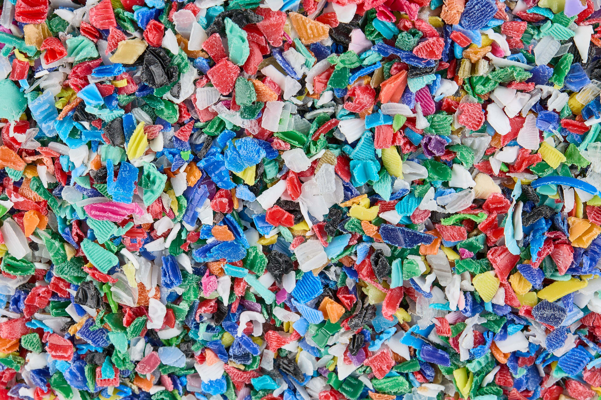
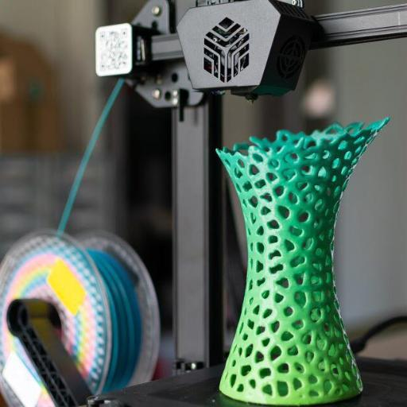

<!-- HERO -->
:::{.hero-section}
:::{.hero-content}

[RESEARCH · MATERIALS · CIRCULARITY]{.eyebrow}

# Turning plastic waste into tomorrow's   materials.

Exploring distributed upcycling of mixed plastic waste through open-source additive manufacturing.

:::{.hero-buttons}

[Discover the project →](research/){.btn-primary}

[Explore our research ↓](research/){.btn-secondary}

:::
:::
:::

<!-- TRANSFORMATION -->
:::{.process-section}

:::{.section-intro}
  
## From waste to new possibilities

UP3DCYCLING transforms mixed plastic waste into high-performance materials for 3D printing.

[OUR APPROACH]{.eyebrow}
:::

:::{.process-grid}

:::{.process-card}

{alt="Mixed plastic waste"}
[01]{.step-number}

### Mixed plastic waste
Give a new purpose to post-consumer plastics.

:::

:::{.process-card}
{alt="Recycled plastic pellets"}
[02]{.step-number}
      
### Reactive compatibilization

Enhance the properties of mixed plastic blends.

:::

:::
:::

<section class="process-section">

OUR APPROACH
<h2>From waste to new possibilities</h2>

 UP3DCYCLING transforms mixed plastic waste into high-performance materials for 3D printing.

01
<h3>Mixed plastic waste</h3>

Give a new purpose to post-consumer plastics.

02
<h3>Reactive compatibilization</h3>

Enhance the properties of mixed plastic blends.

03
<h3>Open-source 3D printing</h3>

Create high-performance materials locally.

</section>